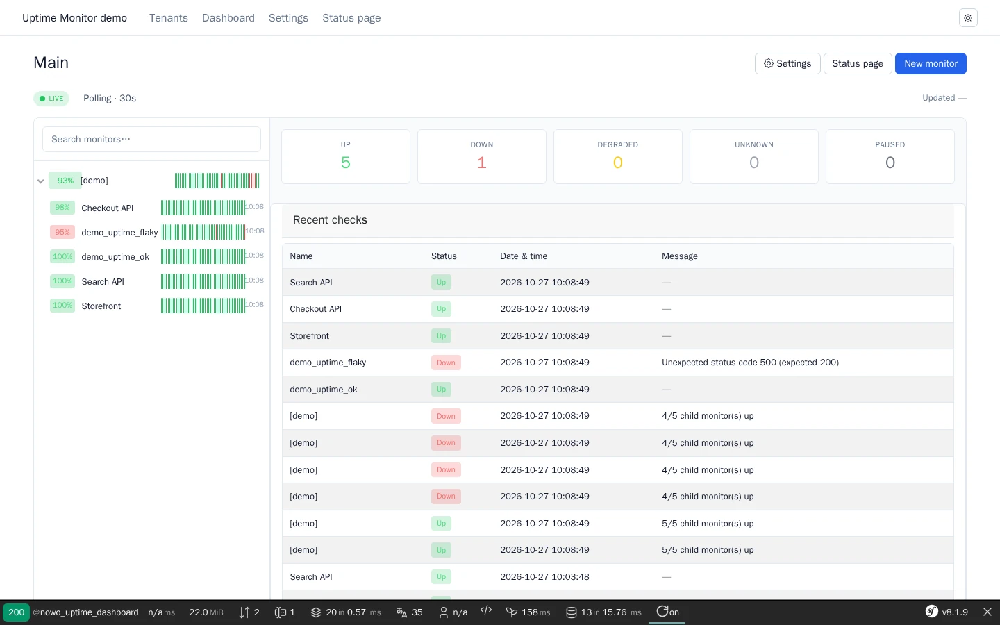
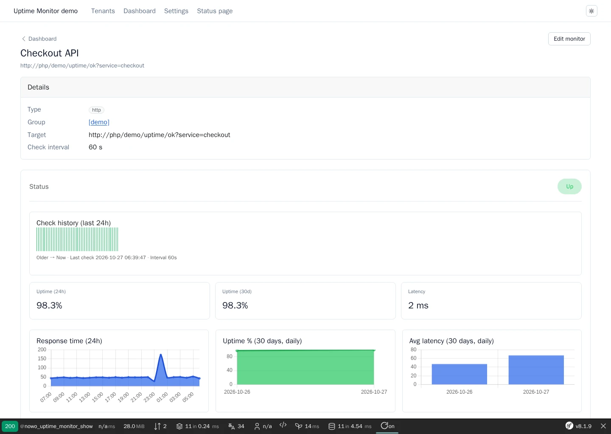

# Uptime Monitor Bundle

[](https://github.com/nowo-tech/UptimeMonitorBundle/actions/workflows/ci.yml) [](https://packagist.org/packages/nowo-tech/uptime-monitor-bundle) [](https://packagist.org/packages/nowo-tech/uptime-monitor-bundle) [](LICENSE) [](https://php.net) [](https://symfony.com) [](https://github.com/nowo-tech/UptimeMonitorBundle) [](#tests-and-coverage)

> ⭐ **Found this useful?** Give it a star on GitHub! It helps us maintain and improve the project.

**Symfony bundle for synthetic uptime monitoring** (Uptime Kuma–style): scheduled checks, detail retention, perpetual aggregates, multi-tenant dashboard with polling sync, public status page, and notifications.

> 📋 **Compatible with Symfony 7.4+ and 8.x** (PHP 8.2+)


This bundle is **FrankenPHP worker mode friendly**. Checks and notifications run only in CLI / Messenger workers with
explicit per-call deadlines, so they never pin a FrankenPHP thread — see [Timeouts](docs/CONFIGURATION.md#timeouts-frankenphp-safe-req-runtime-001).

## Screenshots

<table>
  <tr>
    <td align="center" width="50%">
      
      <br /><sub>Multi-tenant dashboard — heartbeat history, live status counters and recent checks</sub>
    </td>
    <td align="center" width="50%">
      
      <br /><sub>Monitor detail — 24 h heartbeat, uptime ratios and response-time chart</sub>
    </td>
  </tr>
</table>

Captured from the Symfony 8 demo (seeded monitors + 24 h of history) by Playwright: `make demo-screenshots` refreshes them.

## Features

- ✅ HTTP/HTTPS, TCP, DNS, SSL certificate, and Ping (ICMP) checks
- ✅ Symfony Scheduler + `nowo:uptime:run-due-checks`
- ✅ Ops CLI: `nowo:uptime:rollup`, `nowo:uptime:purge-detail`, `nowo:uptime:clear-data` (plus `sync-schema` / `seed-demo`)
- ✅ Doctrine entities: tenant, monitor, check result, aggregates, incidents
- ✅ YAML retention (`detail_days`) + aggregates kept forever
- ✅ REST summary API for dashboard polling (`?since=` delta support)
- ✅ Vite + TypeScript dashboard and Chart.js charts
- ✅ Public status page per tenant (`/status/{tenantSlug}`)
- ✅ Email, webhook, Slack notifications (on status change)
- ✅ CRUD for monitors and tenants (Twig UI)
- ✅ Demo Symfony 7 and 8 (FrankenPHP) — see [docs/DEMO-FRANKENPHP.md](docs/DEMO-FRANKENPHP.md)
- ✅ Mercure real-time dashboard sync (`dashboard.sync: mercure`)

## Quick start

```bash
composer require nowo-tech/uptime-monitor-bundle
```

```yaml
# config/packages/nowo_uptime_monitor.yaml
nowo_uptime_monitor:
    retention:
        detail_days: 30
```

```bash
php bin/console nowo:uptime:sync-schema
php bin/console nowo:uptime:seed-demo
php bin/console nowo:uptime:run-due-checks
# ops: nowo:uptime:rollup · nowo:uptime:purge-detail · nowo:uptime:clear-data
```

Dashboard: `/uptime/{tenantSlug}` · Status page: `/status/{tenantSlug}` (default tenant `main`).

## Development

```bash
make up
make test
make assets
make -C demo up-symfony8
```

Demo Playwright e2e and README screenshots (**REQ-DEMO-013**, Playwright runs in the official Docker image against `demo/symfony8`):

```bash
make test-e2e           # dashboard, monitor create + detail, public status page, settings
make demo-screenshots   # reseeds the demo and refreshes docs/images/demo/*.webp
```

## Documentation

- [Installation](docs/INSTALLATION.md)
- [Configuration](docs/CONFIGURATION.md)
- [Usage](docs/USAGE.md)
- [Templates (UiKit page contract)](docs/TEMPLATES.md)
- [Contributing](docs/CONTRIBUTING.md)
- [Code of Conduct](CODE_OF_CONDUCT.md)
- [Changelog](docs/CHANGELOG.md)
- [Upgrading](docs/UPGRADING.md)
- [Release process](docs/RELEASE.md)
- [Security](docs/SECURITY.md)
- [Engram](docs/ENGRAM.md)
- [Spec-driven development](docs/SPEC-DRIVEN-DEVELOPMENT.md)
- [GitHub Spec Kit](docs/SPEC-KIT.md)

### Additional documentation

- [PSR evaluation (REQ-CS-007)](docs/PSR.md)
- [GitHub Actions CI requirements](docs/GITHUB_CI.md)
- [Scheduling](docs/SCHEDULING.md)
- [Check types](docs/CHECK-TYPES.md)
- [Monitor configuration (Uptime Kuma parity)](docs/MONITOR-CONFIGURATION.md)
- [Tenant settings (Uptime Kuma parity)](docs/SETTINGS.md)
- [Translations (en, es)](docs/TRANSLATIONS.md)
- [Notifications](docs/NOTIFICATIONS.md)
- [Mercure real-time sync](docs/MERCURE.md)
- [Demo with FrankenPHP](docs/DEMO-FRANKENPHP.md)

## Tests and coverage

Measured on 2026-10-27 (same commands as CI):

| Language | Line coverage | Gate | Command |
|----------|---------------|------|---------|
| PHP | **100%** (4296/4296 lines, 525/525 methods) | 100% — `composer test-coverage-100` fails below it (CI `coverage` job, `make release-check`) | `make test-coverage-100` |
| TypeScript | **99.08%** lines (Vitest v8) | 90% — `vitest.config.ts` thresholds (CI `frontend` job, `make test-ts`) | `make test-ts` |
| Python | N/A (no Python code) | — | — |

- **PHP** — PHPUnit `tests/Unit` and `tests/Integration`. Repository, schema-sync, dashboard read-model, backup and
  console-command tests run against a real Doctrine ORM schema (PHPUnit group `db`: `vendor/bin/phpunit --group db`)
  on in-memory SQLite, and on MySQL and PostgreSQL with `make test-with-db` (`UPTIME_TEST_DATABASE_URL`). Network
  checks run offline: `MockHttpClient` for HTTP, a fake `SocketConnectorInterface` and DNS lookups for
  TCP/SSL/DNS/ping, and a loopback-only TLS server for the default socket connector. Time-dependent code is tested with `Symfony\Component\Clock\MockClock`.
- **Measured scope** — all of `src/` (controllers and the Twig extension included); no exclusion in
  `phpunit.xml.dist` and no `@codeCoverageIgnore`.
- **TypeScript** — Vitest specs for the dashboard assets (`src/Resources/assets/src/*.test.ts`); the run fails below
  the 90% thresholds of `vitest.config.ts`.

```bash
make test
make test-coverage
make test-coverage-100
make test-ts
make release-check
```

## License

MIT — see [LICENSE](LICENSE).
