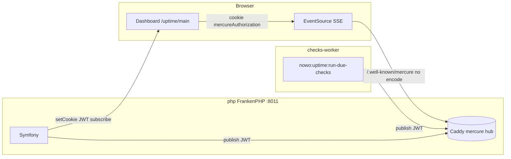

# Mercure in the demo (Symfony 8)

The demos use **`dashboard.sync: mercure`**: the dashboard receives checks in real time over **SSE** (Server-Sent Events), not via continuous API polling.

## URLs

| Demo | Dashboard | Hub in browser (same origin) |
|------|-----------|------------------------------|
| Symfony 8 | http://localhost:8011/uptime/main | http://localhost:8011/.well-known/mercure |

The hub is **built into the demo FrankenPHP server** (Caddy `mercure` directive), so it is always on the **same origin
as the app** and the browser sends the JWT subscription cookie. The same hub serves FrankenPHP `hot_reload`. There is no
separate Mercure container or host port.

## Docker architecture



| Service | Role |
|----------|-----|
| **php** | Web app + built-in Mercure hub (validates publisher and subscriber JWT); JWT cookie when loading the dashboard |
| **checks-worker** | Loop every 15 s: runs checks and **publishes** to the hub on `php` (internal `MERCURE_URL`) |

## Environment variables

In `demo/symfony8/.env` (or `.env.example`):

```env
MERCURE_URL=http://php/.well-known/mercure
MERCURE_PUBLIC_URL=http://localhost:8011/.well-known/mercure
MERCURE_JWT_SECRET=!ChangeThisMercureHubJWTSecretKey!
```

| Variable | Usage |
|----------|-----|
| `MERCURE_URL` | Symfony and the worker **publish** here (Docker network, hostname `php`) |
| `MERCURE_PUBLIC_URL` | URL seen by the **browser** (same origin as the app) |
| `MERCURE_JWT_SECRET` | Shared key: Caddyfile `publisher_jwt` / `subscriber_jwt` + `config/packages/mercure.yaml` |

## Symfony configuration

`config/packages/nowo_uptime_monitor.yaml`:

```yaml
dashboard:
    sync: mercure
    poll_interval_ms: 30000   # only if Mercure fails in the browser
    mercure:
        topic_template: '/uptime/{tenant}'
        private: true
```

`config/packages/mercure.yaml`:

```yaml
mercure:
    hubs:
        default:
            url: '%env(MERCURE_URL)%'
            public_url: '%env(MERCURE_PUBLIC_URL)%'
            jwt:
                secret: '%env(MERCURE_JWT_SECRET)%'
                publish: ['*']
                subscribe: ['*']
```

## Security (JWT, no API key)

No API keys are needed in the front end. The flow follows the standard **Symfony Mercure Bundle**:

1. **Publish** (backend): the worker and Symfony use `MERCURE_URL` + JWT (`publish`).
2. **Private updates**: `mercure.private: true` in the bundle.
3. **Subscribe** (browser): when opening `/uptime/main`, Symfony calls `Authorization::setCookie()` with the tenant topic (e.g. `/uptime/main`).
4. **EventSource** with `withCredentials: true` sends the cookie to the hub (same origin, `:8011`).

In production: change `MERCURE_JWT_SECRET`, use HTTPS, and restrict `publish` / `subscribe` in `mercure.yaml` (avoid `*`).

## FrankenPHP hub (Caddyfile)

Both `docker/frankenphp/Caddyfile` (worker) and `Caddyfile.dev` (classic) declare the hub in the site block and keep
`/.well-known/mercure` out of `encode` compression (otherwise SSE breaks with `ERR_INCOMPLETE_CHUNKED_ENCODING`):

```caddyfile
mercure {
    protocol_version_compatibility 8
    publisher_jwt {env.MERCURE_JWT_SECRET}
    subscriber_jwt {env.MERCURE_JWT_SECRET}
    anonymous
}

@compressible not path /.well-known/mercure*
encode @compressible zstd br gzip
```

`hot_reload` needs this hub in the same server block (FrankenPHP fails with `no Mercure hub configured` otherwise).
After changing a Caddyfile run `make -C demo up-symfony8` (rebuilds the image, recreates `php`).

## Browser behavior

| Element | What it indicates |
|----------|------------|
| Badge **Mercure · connected** (green) | SSE open |
| Badge **Mercure · connecting…** | Connecting |
| Badge **Polling · 30s** | Fallback: Mercure unavailable |
| Console `📦 [uptime] script loaded…` | Dashboard assets loaded |
| Console `ℹ️ [uptime] Mercure connected.` | SSE OK (same style as twig-inspector) |
| Network → **EventSource** | `/.well-known/mercure?topic=/uptime/main` on `:8011` |
| Network → **GET summary** | Only on load (and every 30 s on fallback), not every 15 s when Mercure OK |

After `seed-demo --fresh`, JS receives `dashboard_reset` via Mercure or refreshes the layout via `GET /uptime/main/fragment/layout` without a full F5.

## Useful commands

```bash
# Start stack (php with built-in hub + worker)
make -C demo up-symfony8

# Recreate monitors and first checks
make -C demo reset-demo-symfony8

# Verify manual publish
docker compose -f demo/symfony8/docker-compose.yml exec php \
  php bin/console nowo:uptime:run-due-checks

# Hub logs (Caddy mercure handler)
docker compose -f demo/symfony8/docker-compose.yml logs php --tail 50 | grep -i mercure

# Restart PHP only (after Caddyfile or .env change)
docker compose -f demo/symfony8/docker-compose.yml restart php

# Worker must run the check loop (not FrankenPHP)
docker compose -f demo/symfony8/docker-compose.yml exec checks-worker ps aux
# → should show: sh -c while true; do php bin/console nowo:uptime:run-due-checks ...
```

## checks-worker

The `checks-worker` service uses `entrypoint: []` so it does not start FrankenPHP and instead runs the loop:

```yaml
command:
  - sh
  - -c
  - |
    while true; do
      php bin/console nowo:uptime:run-due-checks --no-ansi 2>&1 || true
      sleep 15
    done
```

Without this there are no new checks or Mercure publications.

## Troubleshooting

| Symptom | Likely cause | Action |
|---------|----------------|--------|
| `ERR_INCOMPLETE_CHUNKED_ENCODING` on `/.well-known/mercure` | Caddy `encode` compresses SSE | Use the current Caddyfiles; `make -C demo up-symfony8` |
| Only requests to `/api/.../summary` | Cookie not sent / wrong public URL | `MERCURE_PUBLIC_URL=http://localhost:8011/.well-known/mercure` |
| `php` exits with `no Mercure hub configured` | Old Caddyfile without the `mercure` block | Pull the current Caddyfiles; `make -C demo up-symfony8` |
| Badge **Polling · 30s** | Mercure closed / invalid JWT | Reopen dashboard; check `mercureAuthorization` cookie |
| Monitors not updating | Worker not running | `docker compose up -d checks-worker --force-recreate` |
| Monitor list after seed without F5 | Normal if Mercure down; with SSE OK `dashboard_reset` arrives | `nowo:uptime:seed-demo --fresh`; wait or reload once |

## More documentation

- [../docs/MERCURE.md](../docs/MERCURE.md) — host application integration
- [README.md](README.md) — demo quick start
